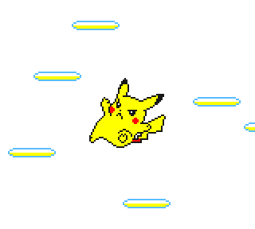
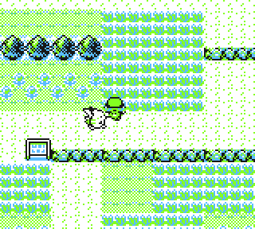
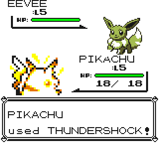
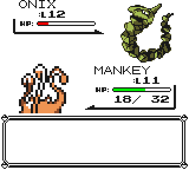
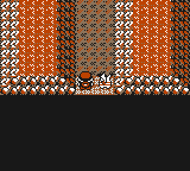

# GBCformer

GBCformer is an experimental Game Boy Color emulator compiled to Llama weights. The CPU, the memory, the graphics, the sound and the control logic all run in one Llama checkpoint.

## What it looks like

Pokémon Yellow on the current weights, `ff86dde7`. Every frame below was decoded by the model in the minimal runner, from one recorded input log that starts at power-on with a new game.

| | | |
| :-: | :-: | :-: |
|  |  |  |
| The intro | Dialogue | Route 1, Pikachu following |
|  |  |  |
| A trainer battle | The first gym | Mt. Moon |

That log runs 193,603 frames, 54 minutes of game time, from power-on to Mt. Moon with the first badge. The runner decoded all of them with no dense fallback, and every frame's hash equals the reference interpreter's for the same presses. The GIFs are at twice the screen's size; five keep every frame and so play 16% slow (a GIF frame lasts a whole number of hundredths of a second), and the Route 1 one drops every second frame.


Oak's introduction with every part of the machine in weights as one model, each part held to its reference in lockstep.

## How it differs

The idea comes from [NESFormer](https://github.com/dbreunig/nesformer), which compiles an NES's CPU into a model. GBCformer differs from it in these ways:

- It uses Meta's Llama layer set, and unpatched llama.cpp b12070 runs it on Metal, Apple's GPU backend (three patches, about 400 lines, only make it faster; "What runs where" below says exactly which builds were run)
- Every major part of the Game Boy Color is in the model: the CPU, memory, graphics, sound and control logic, including the timer, interrupts and DMA control
- Memory lives in attention's KV cache
- The model works out a CPU step in one pass; about 1 step in 100, a read of an I/O register, takes a second
- A compiler writes every weight, and the model matches my reference emulator exactly, step for step

It shares no code with NESFormer.

The host is Rust. It shows the frames, plays the samples, reads the buttons and keeps time. For an MBC3 cartridge clock (Crystal has one; Yellow does not) it hands the control logic the wall time elapsed, as it hands over the buttons; the clock's registers, latch, halt and counting are in the control checkpoint. For the GBC CPU's data reads and writes, the memory model decides which device an I/O access reaches: its address translation names the device in the address it emits, and the host only passes the byte to that device. Every DMA byte comes from the control checkpoint: each run of OAM DMA bytes within an 8-byte OAM line, by its source page, destination page, line and a bit per byte, and each HDMA block's source and destination bits and length, with the M-cycles the CPU stays stopped. The host places the bytes at those bits and runs the stall. Real time runs at the halves per M-cycle the control checkpoint emits. With memory in weights a battery save is the cartridge RAM the model's cache holds, finished when the RAM window the model emits leaves cartridge RAM. The memory model also emits the address of each fetched byte the host serves, each DMA line's translated source and destination, and the second device a register write reaches, and the control and APU checkpoints emit the frame period and the next sample instant. From a boot ROM you supply (`--boot`) the models run the boot itself from power-on: the memory model maps the boot ROM, keeps KEY0 and decides at FF50 whether the console stays in CGB mode, and the PPU checkpoint draws by that decision; the host reads nothing from the header for the mode and hard-codes no post-boot state. The full program (`gbcformer`) still does host work beside the model, for its lockstep and its audit, not for the model's results: it runs its own cartridge mapper on every cartridge write (`Machine::write_memory`, `machine/cart.rs`), so its host copy of the banks follows the game, and it keeps boot bookkeeping beside the model's boot registers. Without a boot ROM it starts from the header's CGB byte and the post-boot state, handed over as a labelled snapshot (`docs/host-in-weights.md` §5 to §7). The minimal runner (`tools/runner`) keeps none of this and reproduces the full program's results. The host counts M-cycles between passes down to the instants the checkpoints emit (each line drawn, each frame-sequencer step, each HALT wake), passes M-cycles and the speed the control checkpoint emits to the APU, and hands each part's outputs to the next, a BCPD or OCPD read included (control names the palette byte, the PPU model reads it). Every run prints this list.

## Run it

You need Rust and your own ROM. This repository holds no ROM and no boot ROM. On Linux the window and the audio need `libasound2-dev` and `pkg-config`.

```sh
cargo build --release
./target/release/gbcformer play game.gbc --weights all --one-model
```

The arrow keys are the D-pad, Z is A, X is B, Enter is Start and Backspace is Select.

Normal play runs nothing but the model and the host.

You can also choose which parts run in the model. `--weights cpu` puts only the CPU in the model and leaves the rest to ordinary Rust code. `--weights all` without `--one-model` runs the parts as six separate checkpoints: the GBC CPU with its memory, the APU, the control logic, the PPU, its line length and its pixel-FIFO stepper.

Checking is a separate, optional mode. `--lockstep all` runs a plain Rust emulator beside the model and stops at the first difference. The tests use it; you don't need it to play.

```sh
# Check 300 frames against the reference emulator
./target/release/gbcformer run game.gbc --frames 300 --weights all --one-model --lockstep all --no-save
# Record 600 frames and their audio, model only
./target/release/gbcformer run game.gbc --frames 600 --weights all --one-model --wav out.wav --record frames --no-save
```

Running `./target/release/gbcformer` with no arguments lists every flag.

## What runs where

Everything here is llama.cpp b12070 (commit `00f113ec`) on an M1 Max, and the model is the current one model, `ff86dde7`, unless a row names another. The unpatched source appears in two builds. "The default build" uses llama.cpp's own default options, which on a Mac turn on Metal and BLAS (Apple's Accelerate). "The BLAS-off build" adds `-DGGML_METAL=ON -DGGML_BLAS=OFF`. Both cmake lines are in `docs/stock-llama.md`, "What runs where".

| Runtime | Build | File | Status | Checked to |
|---|---|---|---|---|
| Metal, Apple's GPU backend | unpatched source, the default build | the one model as one uniform GGUF (sha1 `2f87678b…`, 1,544,154,592 bytes) | **The claim of record.** Every pass runs every weight of the model | Yellow from the hand-off state to frame 300: all 1,374,538 passes equal to the engine's record, and frame 300 hashes to `cfd31f3d…`. This run is the proof of record (2026-11-25, 15 h 28 min 31 s with the GPU lock; `docs/perf-log.md`, "The proof of record on `ff86dde7`"). Two one-frame runs of Zelda DX on this build and file cover what Yellow's 300 frames do not (2026-11-26): frame 7 with 438 lines lent (21,110 passes) and frame 25 with the pixel stepper (14,982 passes, 3,392 of them the stepper's), every pass equal to the engine's record (`docs/perf-log.md`, "Loans and the stepper in unpatched llama.cpp") |
| Metal | unpatched source, the BLAS-off build | the same file | History, the build of the first proof. Decodes correctly | Yellow through frame 13, all 138,984 passes equal, and no more. The first proof (2026-11-23) ran this build on an older model, `45bfb056`, in that model's uniform file: Yellow's 300 frames, all 1,374,538 passes equal, 71 h 34 min with the GPU lock |
| Mac CPU backend | unpatched source, the default build | the same file | Decodes correctly | Yellow's first 400 passes equal to the record, and no more |
| Mac CPU backend | unpatched source, the BLAS-off build | the same file | **NaN at the first GBC CPU pass** | measured on `45bfb056`, `7b064d51` and `ff86dde7` |
| Mac CPU backend | unpatched source, BLAS off, with `-DGGML_NATIVE=OFF -DGGML_CPU_ARM_ARCH=armv8.4-a+nofp16` | the same file | Decodes correctly | Yellow's first 400 passes equal, and no more. `7b064d51`: 400 passes. Not run on `45bfb056` |
| Metal | three patches on the same source (`layer-shapes.patch`, `stream-slices.patch`, `stored-runs.patch`), BLAS off | the trimmed GGUF | A speed-up only, never the claim. Each pass runs its stream's slice of the model | 3,000 passes of Yellow with every sliced pass also decoded by the whole model, 0 rows differ; 4,000 and 3,500 passes of Yellow and Zelda DX to frame 7 (21,110 passes), all equal to the record. A GBC CPU pass takes 12.0 ms against 35.4 unpatched (measured); the 300 frames are not run (6.4 hours, inferred) |
| Any other backend (x86, CUDA, Vulkan) or llama.cpp version | | | Not run | |

What the proof of record covers, and what it does not:

- It starts at the hand-off state the host sets up without a boot ROM (`boot none, warmup 0` in its checkpoints). It does not run the boot ROM from power-on.
- Every pass runs every weight, but a pass attends its stream's scope of the cache's cells, not every cell (`docs/stock-llama.md` §13, "The scopes narrowed"). Each scoped GBC CPU, PPU and length pass was held to the lines that the engine's record says its heads read. No pass was decoded a second time over every cell.
- Yellow lends no lines in 300 frames, and the pixel stepper's stream has no pass, so the proof of record exercises neither. Two separate runs on the same build and file do, each one frame of Zelda DX after frames the reference interpreter ran (`--warmup`). Frame 7 lends lines: all 21,110 passes equal the engine's record, 438 lines lent and put back in 876 write-record decodes, the 424 cells that the harness compares after the put-back all equal to the cells found, and 2,250 write records, those 876 decodes and 160 reader records each decoded both ways with 0 cells and 0 rows that differ. Frame 25 has the stepper: all 14,982 passes equal, 3,392 of them stepper passes that draw one line. Not run in unpatched llama.cpp: a stepper pass in Yellow, Crystal or Mario DX (their first is at frame 1,154, 3,087 and 1,627), a stepper pass on a DMG on `ff86dde7`, a frame with both loans and stepper passes, and more than one frame of either.
- The harness binary had its library search path changed to the run's folder and was signed again ad hoc. The run's `STATUS` file records the sha1 before and after (the run's folder is local and not in this repository; `docs/perf-log.md`, "The proof of record on `ff86dde7`", quotes it).
- The first proof used the BLAS-off build. On Metal the two builds gave the same rates over 3,000 passes (`docs/perf-log.md`, "Round 14").

The Mac CPU rows differ by build options only: no source patch, and no file or weight differs. With BLAS off, the Arm build sums products in 16-bit floats, and a whole-model pass runs every other stream's units at every position, where some of their sums pass 65,504, the largest 16-bit float (1,863 of the model's 76,143 gate rows can: `cargo run --release --example f16foreign`). Metal sums in 32-bit floats, and so does a build without FP16 vector arithmetic (`+nofp16`). That Accelerate is what makes the default build right is inferred from these runs; which multiplies it takes was not traced. Every Mac CPU run here started from a cache that Metal prefilled.

In every row a pass decodes its stream's own group of tokens (`STOCK_GROUP=own`), never the whole sequence, and that is what both proofs ran. Over the whole sequence the other parts' positions carry those parts' modes over this stream's bytes, values no part computes exactly, and on Metal the rows of a GBC CPU pass then differ from its own group's (measured on `ff86dde7` and on `7b064d51`: 148 rows at the first GBC CPU pass; `docs/stock-llama.md` §12a).

## Size and speed

The model is Meta's Llama layer set. The claim is that unpatched llama.cpp b12070 runs it on Metal ("What runs where", above, names the build): as one uniform Llama checkpoint (every layer the widest layer's shape, every row and column present) it is 769.3M dense parameters in a 1,544,154,592-byte GGUF, about 1.39M of them nonzero, and llama.cpp loads that file as it ships and runs the whole model every pass (`docs/stock-llama.md` §13). The same weights also have a trimmed form with per-layer shapes: each layer stores only the heads and FFN units it uses, and the file leaves out the rows and columns of the LM head, the embedding and each `ffn_up` that are constant or zero. That GGUF, the canonical artifact, stores 382.0M parameters in 769,593,632 bytes. It is the form the minimal runner reads, and llama.cpp needs three patches to load it (`tools/stock-llama/layer-shapes.patch`, `stream-slices.patch` and `stored-runs.patch`, about 400 added lines). The patches are speed-ups only, and their rows are checked bit for bit against the unpatched run. `cargo run --release --example digest` prints the size of every checkpoint, and `digest --gguf` checks a file's tensors and manifest against the compiled model.

What the parameters hold is the hardware's rules: the CPU, the memory's address translation, the PPU, the APU and the control logic. The cartridge ROM, the boot ROM and every RAM are not parameters: they are the KV cache's cells, written as the game loads and runs. The board's starting state for each supported cartridge and console, and the wiring table that says how the streams feed each other, are metadata in the GGUF beside the tensors.

Speed, measured on an M1 Max on the current weights, `ff86dde7`: headless and unpaced, saves off, start-up off the clock, 600 frames of Pokémon Yellow as one model with every component in weights, plain release build (`docs/perf-log.md`, "Round 14"; 1-minute load 3.4 to 5.9):

| Scene | Minimal runner (fps, median and range) | Full program (fps, median and range) |
| - | - | - |
| Text box | 63.6 (63.0 to 64.4) | 62.25 (61.2 to 62.7) |
| Overworld | not timed | 130.6 (129.3 to 131.0) |
| Rival battle | not timed | 83.6 (83.1 to 85.2) |

The overworld and battle rows are three runs each of the full program (2026-11-26, 1-minute load 5.4 to 17 while another job ran; the text box measured 63.3, 62.8 to 63.9, in the same series). Every run reached its scene's frame hash with no dense fallback. The text box is the slowest of the three scenes, not a proven worst case. Each scene is set up by the reference interpreter (the `--warmup` frames, labelled as such) and then timed on the model. The engine uses several threads and computes each pass incrementally behind guards; a failed guard falls back to the dense pass or stops, and these runs had no fallback. `tools/build-pgo.sh` makes a profile-guided build trained on the same three scenes, which is about 2% faster and is not the build quoted here.

When you play, the game runs at the Game Boy Color's own 59.73 frames per second. The window paces every frame to that rate, so a faster model never makes the game run fast. The numbers above are how fast the model can go when nothing holds it back. They come from `run`, which does not pace. Anything above 59.73 is headroom.

These numbers come from my own engine, not from an ordinary Llama runtime. It computes the same tokens as a plain forward pass of the weights, but it works out only what changed since the last step, uses integer arithmetic, and answers memory reads with lookups that are checked against attention. It falls back to the plain forward pass, never to the reference emulator. Unpatched llama.cpp on Metal runs a GBC CPU pass of the current weights in about 35 ms, and with the three patches in about 12 ms (`docs/perf-log.md`, "Round 14"), both far below real time.

`tools/bench/text.sh --weights all --one-model` runs the text-box workload, `overworld.sh` and `battle.sh` the others.

## How I check it

`tools/gate.sh` runs every check below but the llama.cpp run and the census. On the current weights it printed 67 `ok` lines, no `FAIL` and one skip, the DMG boot ROM proof without a `dmg_boot.bin` (2026-11-27). It needs the test data in `vendor/` (`CLAUDE.md` lists it; none of it is in this repository) and four game ROMs of your own in the repository root, under the names the script uses: `pokemon-yellow.gbc`, `pokemon-crystal.gbc`, `legend-of-zelda-links-awakening.gbc` and `super-mario-bros-deluxe.gbc`. `cargo test --release` alone needs none of it: the tests that read the SingleStepTests cases or a ROM skip without them and say so (`-- --nocapture` shows the line). The gate fails without the SingleStepTests cases.

- All 500,000 cases of [SingleStepTests/sm83](https://github.com/SingleStepTests/sm83), on the circuit and on the checkpoint
- The fast engine against a plain Hugging Face style Llama forward pass, token for token
- Yellow, Crystal, Link's Awakening DX and Mario DX for 300 frames with everything in weights, in lockstep (frame 300 hashes to `cfd31f3d…`, `ccfe7ad3…`, `f10b2b4a…` and `ea7f86ca…`)
- Yellow for 300 frames as one model, in lockstep
- blargg's `instr_timing` with the CPU and control logic in weights, and `dmg_sound` 01 to 04 with the sound and control logic in weights
- dmg-acid2 and cgb-acid2, pixel for pixel, with the CPU, memory, graphics and control logic in weights
- The boot ROM run by the model with every part in weights and in lockstep, DMG, CGB and a DMG cartridge on a CGB, with the whole state at the hand-off (registers, time, I/O registers, display bytes, every RAM) equal to a reference run of the same boot ROM (`examples/boot_proof`)
- The step oracle on all six streams, and on the memory records, against the dense pass; a test shows it fails on one changed weight or one changed token
- The minimal runner (`tools/runner`), which links none of the emulator and moves bytes between the model's six streams by a table the compiler writes into the GGUF, against the full program, every pass of every stream, every frame, sample and save: Yellow 300 from the hand-off, from power-on and from a mid-game snapshot, Crystal from a snapshot, and test ROMs chosen to reach its rarer paths, most with a counter that shows the path ran (HDMA through a HALT, a DMG's read and write locks, the OAM corruption bug, fetches under the locks, the stepper's lines); for the HALT bug's two reads across a lock edge the runner's records equal the one model's, whose log `tests/halt_bug_locks.rs` pins ([docs/minimal-runner.md](docs/minimal-runner.md))
- Yellow from the hand-off to frame 300 in unpatched llama.cpp b12070 on Metal, built with llama.cpp's own default options, every weight of the uniform model in every pass, on the current weights, `ff86dde7`: all 1,374,538 passes equal to the engine's record, and frame 300's hash equal to the full program's. The run took 15 hours 28 minutes of GPU time in 3 chunks, and each resume replayed the host from the engine's record up to its checkpoint. A pass attends its stream's scope of the cache's cells, not every cell. Yellow lends no cells in 300 frames and the pixel stepper has no pass, so this run exercises neither ([docs/perf-log.md](docs/perf-log.md), "The proof of record on `ff86dde7`").
- Plain runs against lockstep runs: every pass of every stream equal, every event, the memory core's audit-only slots left out of both

## Not done yet

- The full program's host copies. The full emulator still runs its own mapper and boot bookkeeping beside the model (above); the minimal runner shows the model needs neither, and a release would drop them from the full program too
- A full run in patched llama.cpp of any current checkpoint. The patches are a speed-up only, and the unpatched run above is the claim. On the current weights, `ff86dde7`, patched llama.cpp on Metal has bounded runs that held every pass: 3,000 passes of Yellow with each sliced pass also decoded by the whole model, 4,000 and 3,500 passes of Yellow, and Zelda DX to frame 7 with its loans. The 300 frames project at about 6.4 hours there (inferred; `docs/perf-log.md`, "Round 14").
- On the current weights, a llama.cpp run from power-on, and more than one frame of a game that lends cells or of the pixel stepper. The proof starts at the hand-off, and Yellow lends no cells and marks no line in 300 frames. One frame each of Zelda DX covers the loans and the stepper in unpatched llama.cpp ("What runs where"; `docs/stock-llama.md` §13, `docs/hardware-tests.md` §5.4)
- Hardware accuracy past the test census. The model matches my reference emulator exactly, and with everything in weights as one model it passes 321 of 321 in the declared census on the current weights, `ff86dde7` (run 2026-11-26), post-boot: each case starts at the hand-off from the state the host sets up without a boot ROM. The census, its pinned ROM hashes and its 127 exclusions by class are in `docs/hardware-tests.md` §2.4. gbmicrotest and Mealybug's PPU tests on a CGB E are outside it. Passing the census does not show the list of limits is complete; every known one is in `docs/hardware-tests.md` §5, in short:
  - Not built: SameBoy's early CGB OAM lock (OAM locked from a line's start on a CGB, in CGB and compatibility mode; no census case reaches it)
  - Open: where an HDMA transfer runs off its destination (here at VRAM's end, in SameBoy at the 16-bit address's wrap; hardware not established)
  - Approximated: a fetched byte the host serves (code run from an I/O register or IE) is read when the step opens, not at its own M-cycle; no census ROM or game does this
  - Measured, cause not traced: from Nintendo's CGB boot ROM, DIV at the hand-off is 3,328 M-cycles short of hardware's, modulo 16,384 (or 13,056 long), so mooneye `boot_div-cgbABCDE` fails from the boot ROM and passes post-boot
  - Inferred, built into the reference and the model alike, pinned by no outside source: a speed switch raising the STAT line, the HBlank request's edge away from SCX 1 and 2, one HBlank block a line across the gap between STAT's mode 0 and the request, and a DMG's OAM read lock in line 153's last M-cycle
  - Guards that stop a run where a premise fails, none tripped by the census or the games: one held HBlank request a GBC CPU step, no coincident line and frame signals in one block, no OAM rewrite or copy sharing a line with a write record not landed yet, the stepper's length within a byte
  - Inference management: the passes the runner skips at rests, wakes and step ends are measured to change no frame, sample or other stream's record; that they change no hidden state is inferred
  - Verification: the census is post-boot; unpatched llama.cpp on Metal ran Yellow's 300 frames on the current weights from the hand-off, patched llama.cpp ran bounded prefixes, and a DMG trace through the OAM corruption bug in llama.cpp is owed; the ratchet reads the runner's text, so a decision written without its words is not listed

## Read more

- [One model](docs/one-model.md)
- [The minimal runner](docs/minimal-runner.md)
- [Memory](docs/memory-in-weights.md), [graphics](docs/ppu-in-weights.md), [sound](docs/apu-in-weights.md) and [control](docs/control-in-weights.md) in weights
- [The performance log](docs/perf-log.md)
- [The one model in llama.cpp](docs/stock-llama.md): the builds, the cmake lines and the 300-frame run; [the harness](docs/harness.md) and [the slice stack](docs/slice-stack.md) behind it
- [Hardware tests](docs/hardware-tests.md): the census, its exclusions and the known limits
- [The host's GBC logic](docs/host-in-weights.md), and how it moved into the weights
- Design notes: [hardware-shaped circuits](docs/hardware-shaped.md), [nibble channels](docs/byte-channels.md) and the [architecture census](docs/architecture-census.md)
- Side evaluations on older models, whose code is not in this tree: [MLX](docs/mlx.md), [Core ML](docs/coreml.md) and [lossless weight compression](docs/weight-compression.md); and a design note of which nothing is built, [modern speedups](docs/modern-speedups.md)

## License

Apache License 2.0 or MIT, at your option. See [LICENSE-APACHE](LICENSE-APACHE) and [LICENSE-MIT](LICENSE-MIT).

The reference APU (`src/machine/apu.rs`) is a port of SameBoy's `Core/apu.c` (v1.0.5, commit ea667ad), copyright Lior Halphon, under the Expat licence. The reference pixel FIFO (`src/machine/fifo.rs`) ports the same version's fetcher from `Core/display.c` and its write timing from `Core/sm83_cpu.c`. The notice for both is in [licenses/SameBoy-Expat.txt](licenses/SameBoy-Expat.txt).
